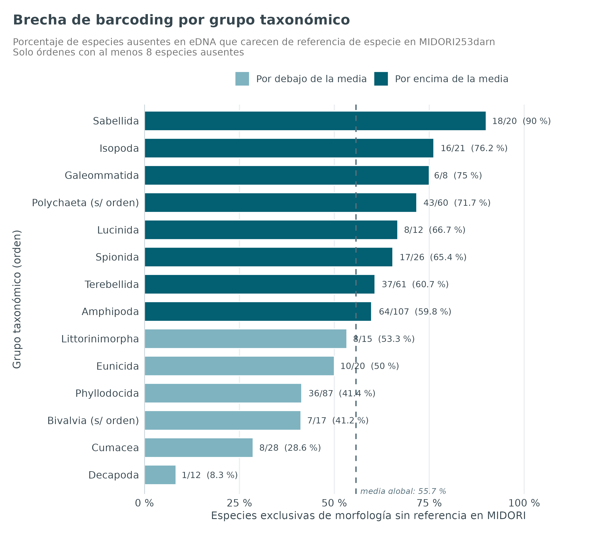
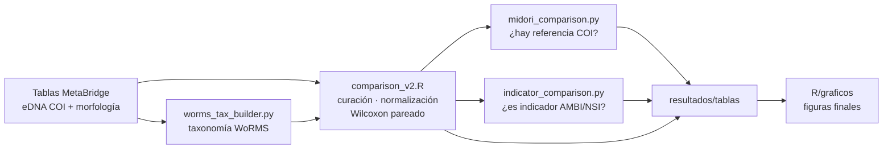

<h1 align="center">Morfotaxonomía vs. metabarcoding de eDNA (COI)</h1>

<p align="center">
  <em>¿Describen la misma comunidad bentónica dos métodos que clasifican igual el estado ecológico?</em>
</p>

<p align="center">
  
  
  
  
</p>

---

Este repositorio contiene el código, los resultados y las figuras del Trabajo Fin de Máster de
**Andrea Moriñigo Velaz**, realizado durante las prácticas en **AZTI**.

El trabajo compara la **identificación morfológica clásica** y el **metabarcoding de ADN ambiental**
(marcador COI) sobre las **mismas estaciones de muestreo** de la plataforma continental noruega,
en el contexto del monitoreo regulatorio del impacto de la extracción petrolífera *offshore*.
Los datos proceden del proyecto **MetaBridge** (NORCE / AZTI, 2018–2022).

La mayoría de los estudios previos comparan el **resultado final** —un índice biótico, la posición
en un gradiente de impacto—. Aquí la comparación se hace **taxón a taxón**, que es donde aparecen
las discrepancias que un índice agregado puede esconder.

## Resultados en una línea

| | |
|---:|:---|
| **1.183 × 144** | OTUs de eDNA COI × muestras analizadas |
| **5 niveles** | clase, orden, familia, género y especie |
| **10,6 %** | de los taxones a nivel de especie fueron detectados por **ambos** métodos |
| **55,7 %** | de las especies exclusivas de morfología **no tienen secuencia de referencia** en MIDORI253darn |
| **86,2 %** | de esas especies perdidas figuran en los catálogos de indicadores **AMBI o NSI** |

<p align="center">
  
</p>

<p align="center">
  <sub>La cobertura de las bases de datos de referencia se ha construido en función del interés
  comercial de los grupos (Decapoda, 8 % sin referencia), no de su relevancia para la
  bioindicación (Sabellida, 90 %).</sub>
</p>

## Objetivos

1. Identificar los taxones y grupos con **diferencias significativas de abundancia** entre métodos.
2. Determinar los **taxones exclusivos** de cada método y las lagunas de cobertura de la base de
   datos de referencia COI.
3. Analizar los **factores** que explican las ausencias y subestimaciones en eDNA.
4. Comparar los **índices bióticos** (AMBI, NSI, NQI1, ISI) calculados con ambos métodos.

## Flujo de trabajo



El procesamiento bioinformático previo —demultiplexado con `cutadapt`, *denoising* con `DADA2`,
agrupamiento en OTUs con `swarm`, curación con `MUMU` y asignación taxonómica con `CREST` contra
MIDORI253darn— fue realizado por el consorcio MetaBridge. **Este repositorio parte de las tablas
de abundancia ya procesadas.**

## Estructura

```
├── R/
│   ├── comparison_v2.R                 Curación de nombres, normalización a abundancia
│   │                                   relativa (denominador a nivel de clase) y test de
│   │                                   Wilcoxon pareado por nivel, con corrección múltiple
│   │                                   (Benjamini-Hochberg y Bonferroni)
│   ├── generate_taxonomic_summary_EN.R Tablas resumen por nivel taxonómico
│   └── graficos/
│       ├── graficos_resultados_TFM_v3_reestructurado.R
│       └── grafico_dispersion_niveles_clasificacion.R
│
├── python/
│   ├── worms_tax_builder.py            Rutas taxonómicas completas vía la API REST de WoRMS
│   ├── midori_comparison.py            ¿Tienen referencia en MIDORI los taxones ausentes?
│   ├── midori_comparison_completo.py
│   ├── indicator_comparison.py         Cruce con los catálogos de indicadores AMBI y NSI
│   └── denominador_A_vs_B.py           Comparación entre dos estrategias de normalización
│
├── resultados/
│   ├── tablas/                         30 salidas (Wilcoxon por nivel, resúmenes,
│   │                                   cobertura MIDORI, dirección del sesgo)
│   └── figuras/                        74 figuras generadas
│
└── anexos/                             Anexos de la memoria: especies, familias y órdenes
                                        ausentes en eDNA, rasgos por taxón, catálogo AMBI/NSI
```

## Cómo reproducirlo

**Requisitos**

- **R** ≥ 4.4 con `dplyr`, `tidyr`, `readxl`, `writexl` y `ggplot2`
- **Python** ≥ 3.10 con `pandas` y `requests`

**Orden de ejecución**

```bash
Rscript R/comparison_v2.R                  # normalización y contraste estadístico
python python/worms_tax_builder.py         # taxonomía de los OTUs de eDNA
python python/midori_comparison.py         # cobertura de la base de datos de referencia
python python/indicator_comparison.py      # condición de indicador biótico
Rscript R/graficos/graficos_resultados_TFM_v3_reestructurado.R
```

## Disponibilidad de los datos

Las tablas de abundancia originales del proyecto MetaBridge **no se incluyen** en este repositorio
por no ser datos propios. Están disponibles a través del consorcio MetaBridge (NORCE / AZTI).
Los scripts las esperan en una carpeta `datos_brutos/` en la raíz del proyecto.

Todo lo que sí se incluye —tablas de resultados, figuras y anexos— es producto de los scripts
de este repositorio.

## Autoría

**Andrea Moriñigo Velaz** · Trabajo Fin de Máster (UNIR) · Prácticas en AZTI
Datos del proyecto MetaBridge (NORCE / AZTI, 2018–2022)
